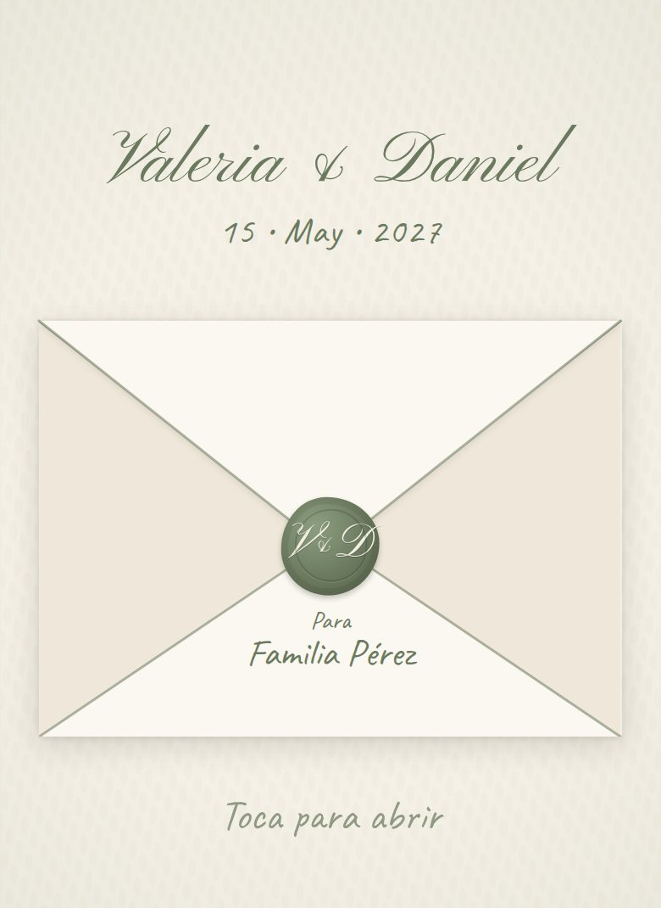
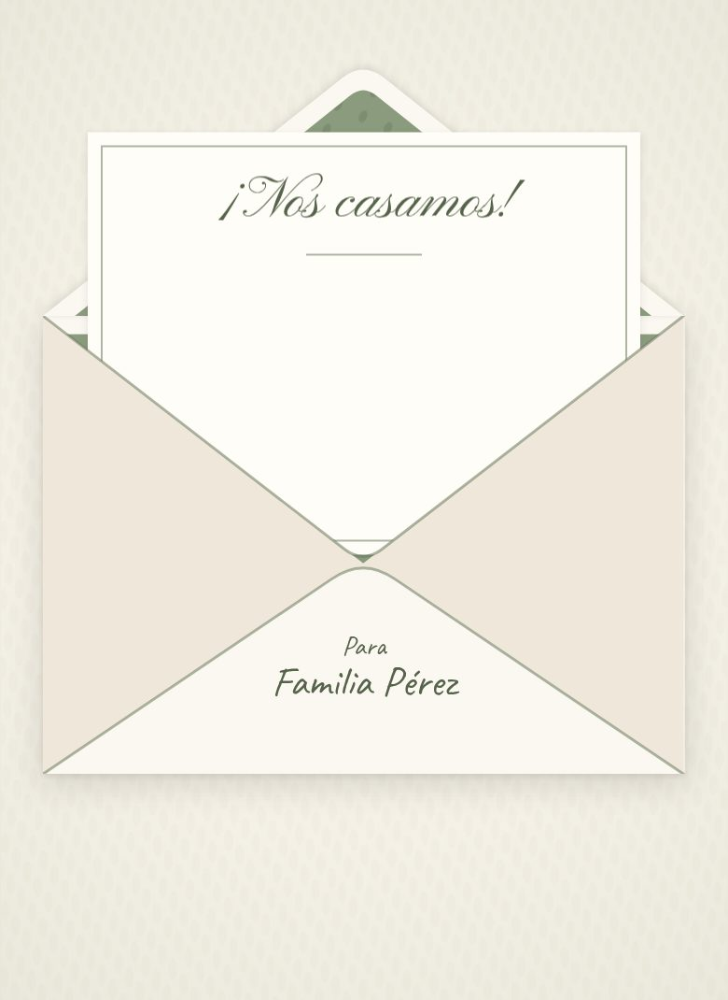
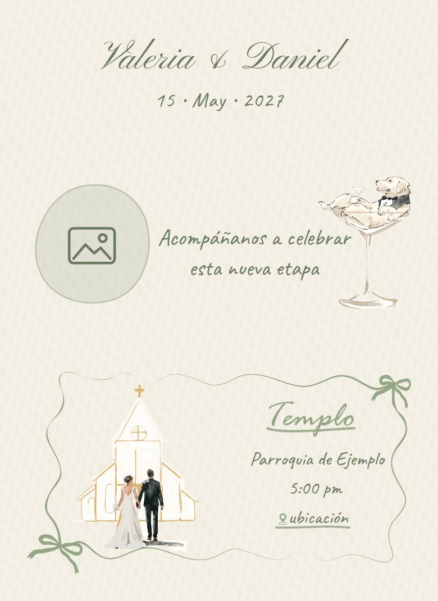
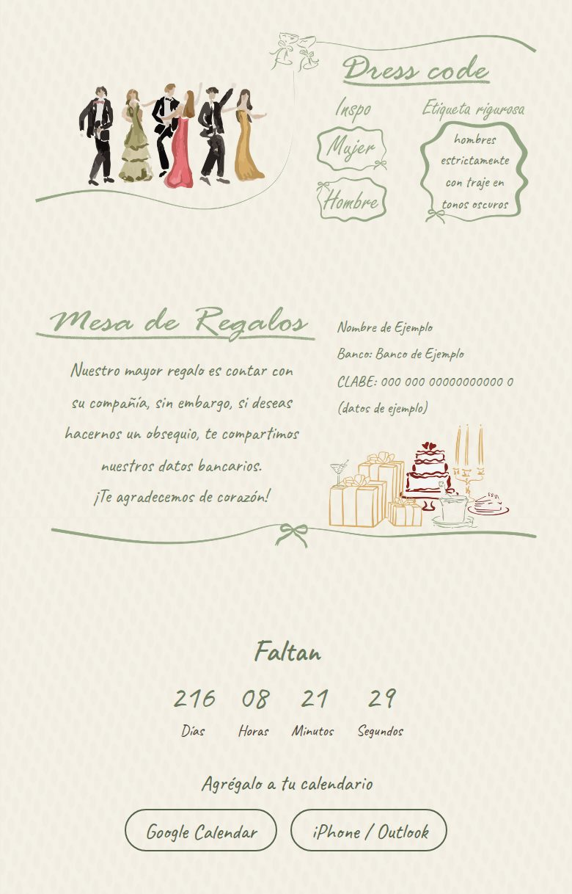
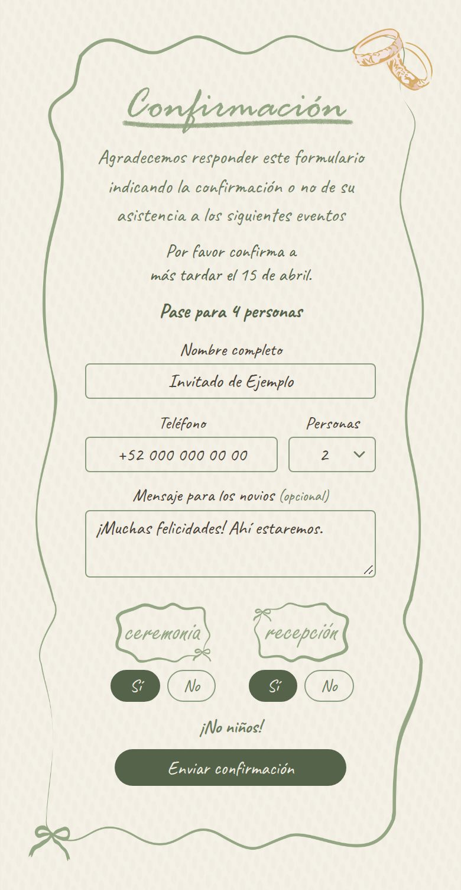

# Wedding Invitation Template

[](https://github.com/lfrocharod/wedding-invitation-template/actions/workflows/ci.yml)

A mobile-first wedding invitation website that opens from an envelope, with background music, scroll animations, a live countdown, an RSVP form and link-preview metadata. All of the content (names, date, venues, dress code, gifts, RSVP texts, the song) lives in one config file and is baked into static HTML at build time.

The site copy is in Spanish; the code and documentation are in English.

**Live demo:** [lfrocharod.github.io/wedding-invitation-template](https://lfrocharod.github.io/wedding-invitation-template/)

## Screenshots

Phone viewport (390px wide) with the placeholder content.

|                                                                           The envelope, with the guest's name from the link                                                                           |                                                                          Opening it                                                                           |
| :---------------------------------------------------------------------------------------------------------------------------------------------------------------------------------------------------: | :-----------------------------------------------------------------------------------------------------------------------------------------------------------: |
|  |  |

|                                                                    Hero and ceremony                                                                     |                                                                                         Dress code, gifts and countdown                                                                                          |                                                                                                 RSVP                                                                                                  |
| :------------------------------------------------------------------------------------------------------------------------------------------------------: | :--------------------------------------------------------------------------------------------------------------------------------------------------------------------------------------------------------------: | :---------------------------------------------------------------------------------------------------------------------------------------------------------------------------------------------------: |
|  |  |  |

## Features

- **Envelope intro:** the invitation starts inside an envelope sealed with the couple's initials. A tap breaks the seal, opens the flap and slides out the letter, then the invitation animates in. It's drawn with CSS and SVG, so there's no artwork to make, and recolored with a few custom properties. It works with the keyboard and isn't shown at all without JavaScript, since nothing could open it.
- **Personalized links:** a link ending in `?para=Familia%20Pérez&pases=4` writes the guest's name on the envelope and offers up to 4 people in the RSVP, so each guest can get their own link, and every RSVP records which invitation it came from.
- **Background music without a visible player:** the song starts with the tap that opens the envelope (browsers block sound before one), fades in, and pauses while the tab is in the background. A pause button appears only on keyboard focus, so keyboard and screen reader users can still stop it.
- **Mobile-first illustrated layout:** a single column (480px max) where text sits on top of the illustrations, positioned with percentages and sized with container query units (`cqw`), so it scales with the artwork on any screen. The RSVP card's frame stretches with the form (`border-image`), and its fields use 16px text, so iPhones don't zoom in when one is tapped.
- **Scroll-reveal animations** with `IntersectionObserver`, starting once the envelope is open. Blocks that come into view together appear one after another. They are opt-in: content only starts hidden when the visitor allows motion (`prefers-reduced-motion: no-preference`) and JavaScript is running, so it's never stuck invisible. With reduced motion, the envelope simply fades away.
- **Live countdown** to the ceremony, read from the config, replaced by "¡Llegó el gran día!" once the day comes.
- **Gift registries:** buttons for online registries (Liverpool, Amazon…) under the gift details, from a list in the config.
- **Add to calendar:** under the countdown, a Google Calendar link and an `.ics` file for iPhone and Outlook, both made from the config at build time, with the two venues and the invitation link in the event.
- **RSVP form** with how many people the answer is for, Sí/No toggles per event, an optional message to the couple, a deadline after which the form closes by itself, a "Ya recibimos tu respuesta" note for guests who come back after answering (remembered in their browser, per invitation link), phone formatting (`+52 000 000 00 00`), validation messages in the form itself rather than pop-up alerts, a honeypot field against bots and two backends: a network-free **demo** mode and a **Google Apps Script** mode that writes each answer to a Google Sheet and can send it to the couple by email, WhatsApp or Telegram.
- **Link previews that work on WhatsApp:** the page title and Open Graph tags are in the static HTML, generated from the config by a small Vite plugin. Link-preview crawlers don't run JavaScript.
- **Private by default:** the page asks search engines not to list it (it shows the couple's names, the venues and their bank details), so it's only reached through the link the couple shares; link previews work the same. The fonts are served with the site instead of by Google Fonts, so opening the invitation sends nothing to third parties, and links out (maps, calendar, gift registries) don't pass on the page address, personalized guest name included.
- **One config file:** `src/invitation.config.js`. A placeholder without a matching value fails the build instead of shipping `{{ … }}` to guests.
- **Accessible:** text colors at the WCAG AA contrast ratio (4.5:1) or better, a real `<h1>` and section headings for screen readers (the visible titles are drawn into the artwork), labelled form controls and toggle groups, the invitation kept out of reach (`inert`) behind the closed envelope, focus moved to the invitation once it opens and to the confirmation message after sending, and `autocomplete` hints.
- **Lightweight:** no framework, about 10 KB of JavaScript (4 KB gzipped), the two fonts in about 110 KB, illustrations compressed to 256-color lossless WebP (the image folder went from 3.4 MB to about 0.8 MB) and a 0.8 MB demo song.
- **Tooling:** ESLint, Stylelint, Prettier, unit tests for the build plugin and the Apps Script backend on Node's built-in test runner, end-to-end tests with Playwright in phone-sized Chromium and WebKit (Safari's engine), Husky hooks that lint and format the staged files and check that commit subjects follow Conventional Commits, and GitHub Actions CI that deploys `main` to GitHub Pages.

## Quick start

Requires Node.js 20.19+ or 22.12+.

```bash
npm install
npm run dev # then open the URL Vite prints (it includes the base path from site.url)
```

## Customize it

### 1. Content: `src/invitation.config.js`

| Key                                                   | What it controls                                                                                                                                                                                                        |
| ----------------------------------------------------- | ----------------------------------------------------------------------------------------------------------------------------------------------------------------------------------------------------------------------- |
| `site.url`                                            | Public URL of the deployed site, without a trailing slash. Used for `og:url` and for the absolute `og:image` URL that WhatsApp needs. Its path is also the base the site is built for, e.g. `/<repo>/` on GitHub Pages. |
| `site.description`                                    | Meta description and link-preview text.                                                                                                                                                                                 |
| `site.ogImage`, `site.ogImageAlt`                     | Link-preview image (1200×630) and its alt text.                                                                                                                                                                         |
| `site.searchable`                                     | `false` (default) asks search engines not to list the site; `true` lets them. Link previews work either way.                                                                                                            |
| `couple.partner1`, `couple.partner2`, `couple.joiner` | Names, joined as "Novia & Novio" in the page title, link preview and header.                                                                                                                                            |
| `couple.photo`                                        | Photo next to the welcome text (586×612 frame; other shapes are cropped, not stretched).                                                                                                                                |
| `date`                                                | Ceremony start in ISO 8601 with the venue's UTC offset, e.g. `2027-05-15T17:00:00-06:00`. Drives the countdown and every displayed date.                                                                                |
| `intro`                                               | Welcome text next to the photo.                                                                                                                                                                                         |
| `ceremony`, `reception`                               | Venue name, time and Google Maps link.                                                                                                                                                                                  |
| `calendar.hours`                                      | How long the celebration lasts. The "Agrégalo a tu calendario" event starts at `date`, at the ceremony venue, and lists both venues and the invitation link.                                                            |
| `dressCode`                                           | Dress code (read by screen readers), the note, and the inspiration links behind the "Mujer" / "Hombre" buttons.                                                                                                         |
| `gifts`                                               | Message, bank details (one line each) and `registries`, buttons for online gift registries: `{ name, url }` each, or `[]` for none.                                                                                     |
| `rsvp`                                                | Intro text, note (e.g. "¡No niños!"), confirmation message, and `maxGuests`, the most people one answer can be for (a [personalized link](#4-envelope) can allow fewer).                                                |
| `rsvp.deadline`, `rsvp.closed`                        | Last day to answer (`YYYY-MM-DD`, or `''` for none), shown as "Por favor confirma a más tardar el 15 de abril". After that day, at the venue's time, the form gives way to the `closed` message.                        |
| `music.src`, `music.volume`                           | The background song (an MP3 in `public/`) and its volume, from 0 to 1. Add `#t=<seconds>` to `src` to skip a long intro. See [Music](#5-music).                                                                         |

In text values, `\n` is a line break; arrays render one item per line, and a list of `{ name, url }` renders as links.

### 2. Images: `public/assets/images/`

Replace the files (keeping their names, or updating the paths in `index.html`). The text over each illustration is positioned with percentages, so artwork with a different composition needs those positions tuned in `src/styles/main.scss`.

The RSVP card is the exception: its frame is cut in two (`rsvp-top.webp`, with the title and the "ceremonia" / "recepción" labels, and `rsvp-bottom.webp`, with the bottom edge) and drawn with `border-image`, so only the plain stretch of the side lines grows and the form can take more fields or longer texts. For a new frame, cut it where its sides run plain, and update the slice sizes listed at the top of `.confirmacion` in `main.scss`.

The section titles and labels ("Templo", "Mujer", "ceremonia", …) are drawn into the illustrations, so their HTML counterparts carry the `visually-hidden` class: screen readers still get them, sighted visitors don't see them twice. If your artwork has no lettering, remove that class in `index.html` and the titles render in place.

### 3. Link preview

Replace `og-image.jpg` (1200×630; keep it small, as WhatsApp may skip images over roughly 300 KB), set `site.url`, deploy, and check the result with a link-preview debugger such as Facebook's Sharing Debugger. WhatsApp caches previews, so when testing changes share the URL with a query string like `?v=2`.

### 4. Envelope

The envelope on the first screen shows the couple's names, the date and a wax seal with their initials, all taken from the config. Its other two texts, "¡Nos casamos!" on the letter and the "Toca para abrir" hint, are in `index.html`.

It's drawn with CSS and the SVG shapes in `index.html`. To restyle it, change the `--envelope-*` custom properties at the top of `src/styles/_envelope.scss` (paper, lines, liner and seal colors). To use your designer's artwork instead, keep the class names, which the script and the animations rely on, and swap the SVG shapes for images. Opening it runs two steps of CSS animations (`is-opening`, then `is-leaving`) and the script waits for each one to end, so the timing lives only in that file.

**Personalized links:** add `?para=` and the guest's name to the link you send, and the envelope reads "Para Familia Pérez". Add `&pases=` and a number to say how many people the invitation is for: the RSVP shows "Pase para 4 personas" and its **Personas** field only goes up to 4 (without it, up to `rsvp.maxGuests`).

```text
https://lfrocharod.github.io/wedding-invitation-template/?para=Familia%20Pérez&pases=4
```

Spaces can be written as `%20` or `+`; send yourself the link first to check how your messaging app handles it. Names are cut at 60 characters and long ones get a smaller font, so they fit. The name is inserted as plain text, so a link can't inject HTML. Without `?para=` the envelope just shows the seal. The passes are a courtesy limit, not a lock: anyone can edit a link, so compare the answers with your list.

The RSVP records the name too: the sheet's **Invitación** column says which link each answer came from, next to how many people it's for, so you can tell who answered for which invitation and spot one that confirmed more people than it was meant for.

To make the links for a whole guest list, put the names in column A of a Google Sheet and the passes in column B, then this in C2 and fill it down:

```text
="https://lfrocharod.github.io/wedding-invitation-template/?para="&ENCODEURL(A2)&IF(B2="","","&pases="&B2)
```

With phone numbers in column D (country code included, digits only, e.g. `520000000000`), this in E2 makes a link that opens WhatsApp with the message ready to send (in a sheet set to a locale with a decimal comma, such as Spain's, separate the arguments with `;`):

```text
=HYPERLINK("https://wa.me/"&D2&"?text="&ENCODEURL("¡Hola! Con mucho cariño te compartimos nuestra invitación: "&C2), "Enviar")
```

To go without the envelope, delete its `<section class="envelope">` from `index.html` and the invitation shows right away. The music starts from the tap on the envelope, so remove the music as well.

### 5. Music

Replace `public/assets/audio/song.mp3` with the couple's song (or point `music.src` at another file) and set `music.volume`. Use an MP3, the one format every browser plays (Ogg doesn't play on iPhones), and keep it light: around 128 kbps is plenty for background music, which keeps a 4-minute song under 4 MB. It downloads while the guest is looking at the envelope.

Browsers only let a page play sound after the visitor interacts with it, and Safari only from inside that interaction, so the song starts from the tap that opens the envelope, not when its animation ends. It loops, fades in over a couple of seconds and pauses while the tab is in the background (for example when a "ubicación" link opens Google Maps), picking up again on return.

There's no visible player. A "Pausar música" button sits at the top of the invitation, invisible until it receives keyboard focus, so keyboard and screen reader users can still stop a song that would otherwise talk over their screen reader. To show it to everyone, delete the `&:not(:focus)` block of `.music-toggle` in `src/styles/main.scss`.

On iPhones a page can't set the volume, so `music.volume` is ignored there and the song plays at the device's media volume. Like a video, it also plays with the silent switch on: that switch silences ringtones and alerts, not media. The pause button and the tab's own mute are the ways out.

The song loops, and every loop restarts with a short gap: MP3 files begin with a few milliseconds of silence (encoder delay), and browsers take a moment to jump back to the start. A song that ends and begins cleanly, as most do, hides it. One cut in the middle of a phrase to loop seamlessly clicks at that point, so let its last notes fade out. The demo song ends that way, letting its last chord ring out before the tune starts again.

To go without music, delete the `<audio>` element and the `music-toggle` button from `index.html`, and the `music` block from the config.

## RSVP setup

The RSVP backend is chosen at build time with `VITE_RSVP_MODE`. Locally, copy `.env.example` to `.env.local`; on your host, set the same variables in its dashboard and redeploy.

| Mode             | Behavior                                                                                                                                                                                                  |
| ---------------- | --------------------------------------------------------------------------------------------------------------------------------------------------------------------------------------------------------- |
| `demo` (default) | No network call. After a short delay the normal confirmation appears, and the payload that would have been saved is logged to the browser console. Safe for a public demo.                                |
| `apps-script`    | POSTs the answer as JSON to `VITE_RSVP_ENDPOINT`, a Google Apps Script web app that appends a row to a Google Sheet. The build fails if the endpoint is missing, and a failed save is shown to the guest. |

### Google Apps Script backend

1. Create a Google Sheet for the answers.
2. Open **Extensions → Apps Script**, replace the contents of `Code.gs` with [`apps-script/Code.gs`](apps-script/Code.gs) and save.
3. Click **Deploy → New deployment**, select the type **Web app** and set:
    - **Execute as:** Me
    - **Who has access:** Anyone
4. Click **Deploy**, authorize the requested permissions and copy the **Web app URL** (it ends in `/exec`). Opening it in a browser should show `{"ok":true,…}`.
5. Set the variables in `.env.local` and on your host:

    ```bash
    VITE_RSVP_MODE=apps-script
    VITE_RSVP_ENDPOINT=<your web app URL>
    ```

6. Rebuild or redeploy, send a test RSVP and check the **RSVP** tab of the sheet. It is created on the first submission, with a header row: Fecha, Nombre, Teléfono, Personas, Ceremonia, Recepción, Mensaje and Invitación (the guest name from a [personalized link](#4-envelope), if any).

Each value goes into the column with its header, so you can reorder the columns or add your own, such as a table number, without breaking anything. A tab created by an older version of the script gets the headers it's missing added at the end, with the next answer.

**Personas** is a number, so the sheet can count the guests. With the columns in their original order, this adds up the people coming to the ceremony (use `F:F` for the reception):

```text
=SUMIF(E:E, "Sí", D:D)
```

After editing the script, publish the change with **Deploy → Manage deployments → Edit → Version: New version**, which keeps the same URL.

Good to know:

- When you authorize the script, Google warns that it "hasn't verified this app". It says that about any personal script, and the developer it names is you: click **Advanced → Go to … (unsafe)**. Then tick every permission it lists: leave one out and the script asks again on its next run.
- `VITE_*` variables are inlined into the public JavaScript bundle. The endpoint isn't a secret; keeping it out of the repo keeps the template generic and away from scrapers.
- "Anyone" access is what lets the browser read the script's reply. The script validates every field, drops honeypot submissions, uses a lock so simultaneous answers don't collide, and stores values starting with `=`, `+`, `-` or `@` as plain text so Sheets never evaluates them as formulas (phone numbers like `+52 …` included).

### Notifications by email, WhatsApp or Telegram (optional)

Instead of checking the sheet, the couple can get each answer by email, WhatsApp, Telegram, or any mix of them:

1. In the Apps Script project, add a script file (**+ → Script**) named `Notifications` and replace its contents with [`apps-script/Notifications.gs`](apps-script/Notifications.gs).
2. Open **Project Settings** (the gear icon) and, under **Script properties**, add the ones for the channels you want (each channel is set up below):

    | Property            | Value                                                                                 |
    | ------------------- | ------------------------------------------------------------------------------------- |
    | `NOTIFY_EMAIL`      | One or more email addresses, separated by commas                                      |
    | `WHATSAPP_TOKEN`    | Access token for the WhatsApp Business Platform                                       |
    | `WHATSAPP_PHONE_ID` | ID of the WhatsApp number the messages come from                                      |
    | `WHATSAPP_TO`       | Numbers to notify, with their country code, e.g. `+520000000000`, separated by commas |
    | `WHATSAPP_TEMPLATE` | Name of the approved message template, e.g. `nueva_respuesta`                         |
    | `WHATSAPP_LANGUAGE` | The template's language code (optional, `es_MX` by default)                           |
    | `TELEGRAM_TOKEN`    | The token @BotFather gives your bot                                                   |
    | `TELEGRAM_CHAT_ID`  | Chats to notify, separated by commas                                                  |

3. Back in the editor, open `Notifications.gs`, select `sendTestNotification` in the toolbar and click **Run**. Authorize the new permissions (sending email as you and connecting to an external service), and a test answer arrives on each channel. If one doesn't, **Executions** shows why.
4. Publish a new version: **Deploy → Manage deployments → Edit → Version: New version**.

A notification that fails is only logged: the answer is saved in the sheet first, either way. Without `Notifications.gs` the script sends nothing and never asks for those permissions. Tokens stay in the script's properties, out of the repository and the site.

**Email** comes from the Google account that owns the script: free, and up to 100 recipients a day on a free account (two addresses use two per answer).

**WhatsApp** goes through the official [WhatsApp Business Platform](https://developers.facebook.com/documentation/business-messaging/whatsapp/) (Meta's Cloud API). Messages a business starts must use a template Meta has approved, and Meta charges a small fee for each one delivered, by country and category ([pricing](https://developers.facebook.com/documentation/business-messaging/whatsapp/pricing)). Setup, once per wedding:

1. In [Meta for Developers](https://developers.facebook.com/apps), create an app of the **Business** type and add **WhatsApp** to it. Its **API Setup** page has a test number to start with, the **Phone number ID** for `WHATSAPP_PHONE_ID`, and a list of recipient numbers you can message during testing (each one confirms with a code). For the wedding itself, add the number that should send the messages.
2. In WhatsApp Manager, create a message template in the **Utility** category, in Spanish (Mexico), named for example `nueva_respuesta`, with this body (Meta asks for a sample value for each variable), and wait for its approval:

    ```text
    Nueva respuesta a la invitación de boda: {{1}} respondió por {{2}}. Ceremonia: {{3}}. Recepción: {{4}}. Teléfono: {{5}}. Notas: {{6}}. Puedes ver todas las respuestas en la hoja de cálculo.
    ```

    The script fills in, in this order: the guest's name, the number of people ("2 personas"), the two Sí/No answers, the phone, and the invitation and message ("—" when there are none). Change the wording if you like, keeping the six variables in that order.

3. The token on the API Setup page expires within a day. For one that lasts, open **Business settings → Users → System users**, add a system user, give it the app and the WhatsApp account, and generate a token with the `whatsapp_business_messaging` permission.

**Telegram** is free and instant, for couples who use it: in Telegram, send `/newbot` to [@BotFather](https://t.me/BotFather) and keep the token it replies with. Each person who should get the messages sends `/start` to the new bot. Then put the token in `TELEGRAM_TOKEN`, run `findTelegramChats` from the editor (it lists the chats that wrote to the bot in the last 24 hours, with their IDs) and copy the IDs into `TELEGRAM_CHAT_ID`.

Free WhatsApp gateways such as CallMeBot aren't used: CallMeBot's API is for personal use only, so it doesn't suit a site made for clients, and in October 2026 it wasn't taking new users.

### Spam protection

The form has a hidden `website` field. People never see it, but bots that fill in every field do. Those submissions get a fake success message and are never sent; the Apps Script drops them too, in case a bot posts to the endpoint directly.

## Scripts

| Command                | Description                                  |
| ---------------------- | -------------------------------------------- |
| `npm run dev`          | Start the Vite dev server                    |
| `npm run build`        | Build the static site into `dist/`           |
| `npm run preview`      | Serve the production build locally           |
| `npm test`             | Run the unit tests                           |
| `npm run test:e2e`     | Build the site and run the end-to-end tests  |
| `npm run lint`         | Run ESLint, Stylelint and the Prettier check |
| `npm run lint:js`      | Run ESLint only                              |
| `npm run lint:css`     | Run Stylelint only                           |
| `npm run format`       | Format all files with Prettier               |
| `npm run format:check` | Check formatting without writing             |

A pre-commit hook (Husky + lint-staged) lints and formats the staged files, and a commit-msg hook checks that the subject follows [Conventional Commits](CONTRIBUTING.md#commit-messages). GitHub Actions checks the commit subjects too, and runs ESLint, Stylelint, the Prettier check, the unit tests, the production build and the end-to-end tests on every push and pull request, and deploys `main` to GitHub Pages once they pass.

The end-to-end tests (`e2e/`) open the built site as a guest would, on an Android-sized Chromium and an iPhone-sized WebKit: the envelope, the music, personalized links, the RSVP from its error messages to the "already answered" note, the deadline, the calendar file, and the page without JavaScript or with reduced motion. They also check that the page loads nothing from other sites. The first run needs the browsers: `npx playwright install chromium webkit` (on Linux, add `--with-deps` for the system libraries).

## Tech stack

- [Vite](https://vite.dev) 8, with a custom `transformIndexHtml` plugin
- Vanilla JavaScript (ES modules), no framework
- SCSS (Dart Sass) with BEM naming and container query units
- Caveat and Pinyon Script, self-hosted through [Fontsource](https://fontsource.org)
- Google Apps Script and Google Sheets for RSVPs
- ESLint, Stylelint (`stylelint-config-standard-scss`) and Prettier
- Node's built-in test runner (`node --test`) and [Playwright](https://playwright.dev)
- Husky + lint-staged, GitHub Actions

## Project structure

```text
.
├── apps-script/
│   ├── Code.gs                     # RSVP backend (Google Apps Script web app)
│   ├── Notifications.gs            # Optional: each answer by email, WhatsApp and/or Telegram
│   └── apps-script.test.js         # Runs both against fake Google services
├── docs/screenshots/               # README screenshots
├── e2e/                            # End-to-end tests (Playwright)
├── plugins/
│   ├── vite-plugin-invitation.js   # Injects the config into index.html at build time
│   └── vite-plugin-invitation.test.js
├── public/                         # Copied as-is: favicon, images and the song
├── src/
│   ├── invitation.config.js        # All of the invitation content
│   ├── scripts/                    # main.js (entry), envelope.js, guest.js, music.js, reveal.js, countdown.js, rsvp.js
│   └── styles/                     # main.scss, and _envelope.scss for the envelope
├── .env.example                    # RSVP mode and endpoint
├── index.html                      # Page template with {{ placeholders }}
├── playwright.config.js            # Phones to test on; builds and serves the site for the tests
└── vite.config.js                  # Registers the plugin, sets the base path, checks the RSVP variables
```

## How the config gets into the HTML

`index.html` contains placeholders such as `{{ couple.names }}` and `{{ ceremony.venue }}`. The plugin in `plugins/vite-plugin-invitation.js` hooks into Vite's `transformIndexHtml` before Vite resolves asset URLs and replaces each placeholder with the matching value from `src/invitation.config.js`. Values are HTML-escaped, line breaks are handled differently in text and in attributes, and a list of `{ name, url }` (the gift registries) becomes links. The plugin also derives a few values, such as the couple's display name, their initials for the envelope's seal, the Spanish date parts used in the title and preview, and the Google Calendar link. It writes the calendar event to `boda.ics` too: served by the dev server, and written to `dist/` by the build. A real file served as `text/calendar` is what iPhones offer to add to the calendar.

Doing this at build time rather than in the browser means the page title, the Open Graph tags and every visible text are in the static HTML that WhatsApp's crawler fetches, and the content doesn't depend on JavaScript to appear.

## Deployment

The CI workflow deploys `main` to **GitHub Pages** after the checks pass. To do the same with your copy:

1. In the repository settings, open **Pages** and set **Source** to **GitHub Actions**.
2. Set `site.url` to `https://<user>.github.io/<repo>`. The build picks up `/<repo>/` as its base path from it.
3. Push to `main`.

`npm run build` writes a static site to `dist/`, so any other static host works too. On Vercel or Netlify, import the repository (the Vite preset is detected automatically: build command `npm run build`, output directory `dist`), set `site.url` to your domain, and add the RSVP environment variables if you use the Apps Script mode.

## Credits

Illustrations © Pao Lepe, used with permission. Not covered by this repo's license and not for reuse.

The demo song (`public/assets/audio/song.mp3`) is a music-box arrangement of Pachelbel's Canon in D, a public-domain composition, synthesized for this template.

## License

The code, and the demo song made for it, are released under the [MIT License](LICENSE). The illustrations in `public/assets/images/`, and the images made from them (the link-preview image and the screenshots in `docs/screenshots/`), are excluded (see [Credits](#credits)).
